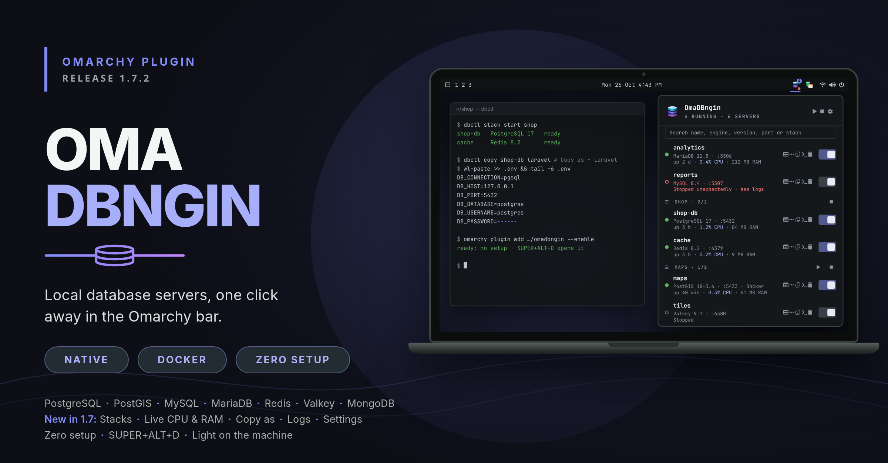

# OmaDBngin: local database servers for Omarchy



**Compatibility:** works with Omarchy 4.5 (checked on 4.5.0-3: manifest validation, the plugin's own tests, and every Omarchy component, command and bar interface it uses).

## What's new in 1.7.3

- **Safer PostgreSQL restores**: a dump is checked before `psql` reads it. A line that would run a
  `psql` client command on your account (`\!`, `\o`, `\i` and the like) makes the restore stop with an
  error, so only plain SQL (and the `\connect` and `COPY` lines `pg_dumpall` writes) gets through.
  `psql` runs with no rc, history or password prompts and only the environment it needs. MySQL and
  MariaDB restores run the client in binary mode, which turns its `\!` and `system` commands off.
- **Redis/Valkey restores keep your old data until the new data works**: the snapshot is first loaded
  in a throwaway server, and the current snapshot and append-only log are only set aside. If the
  restored server does not come up, the old data and settings are put back (native and Docker).
- **Creating a server is one at a time per name**, and a failed create removes only what that
  attempt made, never a folder, service, container or volume somebody else created meanwhile.
  A failing `docker run` now fails the create instead of reporting success.
- **Text fields exist only while the panel is open**: Qt text inputs watch the Wayland clipboard
  for as long as they live, and a slow clipboard owner could stall the shell. A paste (Ctrl+V,
  Shift+Insert, middle click) now reads at most 1 KiB of plain text in a separate process that is
  stopped after two seconds, and every field has a length limit.
- **The new-server password is masked** (use Show to see it), and unfinished drafts are cleared
  when the panel closes.

## What's new in 1.7.2

- The new-server form opens on **Native engine** when Docker is not running or not installed
  (it used to open on Docker container and show an error). If you pick Docker yourself, or a
  Docker-only engine such as PostGIS, that choice is kept.

## What's new in 1.7.1

Compatibility: works with Omarchy 4.5 (checked on 4.5.0-3).

- **Security notes**: a new Security section, and the create form warns when the password is empty.
- **Safer MySQL/MariaDB setup**: the temporary setup server is always stopped and cleaned up, and
  setup no longer waits two minutes for a server that already died.
- **`--keep-data` leftovers** (`<name>.removed-<date>`) no longer show up as a phantom server or
  keep their port reserved.
- **First start after the OmaDB rename** is safe when `setup` and `state` run at the same time
  (locked, and tracked by a `.migrated` marker).
- **`backups`** lists only the exact server's backups (`app` no longer lists `app-staging`).
- **Restores** into PostgreSQL fail (and say why) when SQL errors other than "already exists" occur.
- **Docker port changes and OmaDB moves** keep the old container until the new one exists, and put it back on failure.
- **The client launcher** (it holds the password) is deleted if the terminal cannot be opened.
- **Paths with spaces or `%`** work in the systemd units, and long data paths get a short socket directory.
- **`bind` / `unbind`** write through a symlinked `bindings.lua` instead of replacing it.
- **One broken `server.json`** no longer blanks the panel; the panel shows an error if the state cannot be read.
- **Redis builds** keep their log (`~/.local/share/omadbngin/tmp/redis-<version>-build.log`) when they fail.

## What's new in 1.7.0

- **Bar icon status**: the running count as a badge (or text, or hidden), a red dot when a
  server stops on its own (cleared when you open the panel), and a tooltip listing every server.
- **Richer rows**: uptime, CPU %, memory and data size, and **ready** once a server accepts
  connections (not just when its process runs).
- **Search** when you have more than five servers.
- **Stacks**: group servers per project (e.g. `shop` = Postgres + Redis) and start or stop the
  whole stack at once.
- **Start all / Stop all** in the panel header (only the servers shown when you search).
- **Copy as**: URL, `DATABASE_URL` / `REDIS_URL` / `MONGODB_URI`, Laravel `.env`, Django,
  JDBC or the CLI command.
- **Logs in the panel**, live, besides the terminal view.
- **Settings page** (the gear, or right-click the bar icon): position on the bar (left, center
  or right; first, last, or before/after any widget), the bar icon, compact or detailed rows,
  stats on/off, default mode, default port and user per engine, backup folder, the SUPER+ALT+D
  shortcut and reset to defaults.
- **Zero configuration**: install with `--enable` and it is ready, shortcut included.
- **Light on the machine**: with the panel closed it only listens for start/stop events plus
  one check a minute. CPU, memory and readiness are read from kernel counters, only while
  the panel is open, never with `docker stats`. Measured on the author's machine with one
  server running, the shell used 0.85 % of a core with the panel open (1.6.1: 1.73 %).

A DBngin-style database manager for the Omarchy bar. Click the 󰆼 icon to:

- **Create** a server: choose how it runs (**native engine** or **Docker
  container**), an engine (PostgreSQL, PostGIS, MySQL, MariaDB, Redis, Valkey, MongoDB),
  a version, a name, a port, and the **username and password** to use. A free port is suggested
  automatically, so several versions of the same engine run side by side.
- **Start / stop** it with the switch
- **See** its username and password (󰌆), **copy** its connection URL with them (󰆏), open its **CLI client** in a terminal (),
  follow its **logs** (󰦪)
- Make it **start with the system** (󰐥)
- **Open** it in [OmaTablePlus](https://github.com/blackcodesh/omatableplus) (, when OmaTablePlus is installed)
- **Delete** it and its data (󰆴, click twice)

Each running server shows its uptime, memory and data size; a failed one shows the
last error from its log. The  button opens its tools:

- **Back up** every database to `~/Downloads/<name>-<date>.sql` (Redis/Valkey: an
  `.rdb` snapshot). MongoDB backups are made in OmaTablePlus (*Database ▾ → Back up*).
- **Restore** one of the listed backups (click twice). SQL dumps run against the server (after a
  check that they hold no commands for the client); an RDB snapshot replaces the Redis/Valkey data,
  and the old data comes back if the new data does not start.
- **Move to port**: the server gets a new port and restarts if it was running (Docker
  servers are recreated on the same volume, so the data stays).

The bar shows how many servers are running; hover for the list. Right-click opens the settings.

## Settings

The gear in the panel (or right-click on the bar icon, or
`qs -p /usr/share/omarchy/shell ipc call omadbngin settings`) opens the settings page.
Changes save at once into this widget's entry in `~/.config/omarchy/shell.json`; before each
save the file is copied to `shell.json.omadbngin-settings-backup`.

| Setting | What it does |
|---|---|
| Position on the bar | Left, center or right; first, last, or before / after a widget in that section |
| Running count | Badge on the icon, text next to it, or hidden (1.6's `label: "Icon only"` = hidden) |
| Red dot | Shown when a server stops on its own (failed, non-zero exit, out of memory) |
| Rows | Detailed (uptime, CPU, memory, data size) or compact (one status line) |
| Stats while open | Off: no CPU, memory or readiness work at all |
| New servers run as | Native engine or Docker container |
| Defaults for new servers | Port and username per engine; empty uses the engine's own default |
| Backup folder | Where backups are written and listed (default `~/Downloads`) |
| Shortcut | Adds or removes SUPER+ALT+D (opens the panel) in `~/.config/hypr/bindings.lua` |
| Reset to defaults | Removes every setting from the entry (click twice) |

## Native or Docker

**Native engine** (default) works like DBngin: no Docker, no root, no system
packages.

- The first server of a version downloads the official build once, into
  `~/.local/share/omadbngin/engines/<engine>/<version>/` (versions marked 󰇚 in the
  panel are not downloaded yet). Later servers of that version reuse it.
- Each server gets its own data directory in `~/.local/share/omadbngin/servers/<name>/`
  and runs as the systemd user service `omadbngin-<name>.service`.
  *Start with system* enables that service (it starts when you log in), and
  logs come from `journalctl --user -u omadbngin-<name>`.

| Engine     | Native build                                       |
|------------|----------------------------------------------------|
| PostgreSQL | [theseus-rs/postgresql-binaries](https://github.com/theseus-rs/postgresql-binaries) (relocatable upstream builds) |
| MySQL      | Official `minimal` tarball (glibc 2.28; glibc 2.17 for 8.0) |
| MariaDB    | Official `linux-systemd-x86_64` tarball              |
| Redis      | Built from the official source release (about a minute) |
| Valkey     | Official prebuilt release                            |
| MongoDB    | Official Ubuntu tarball (24.04; 22.04 for 7.0), plus `mongosh` |

**Pinned and verified.** Every build is pinned in [`engines.lock`](engines.lock):
exact version, download URL and SHA-256, taken from what each upstream publishes
(GitHub release digests, MariaDB's API, MongoDB's `full.json`, `redis-hashes`,
Valkey's `.sha256` files; MySQL publishes no SHA-256, so those are hashed when the
lock is made). OmaDBngin never downloads anything that isn't in the lock, and nothing is
unpacked, built or run unless its checksum matches; a mismatch stops the install and
leaves nothing behind. New versions arrive with plugin updates; maintainers
regenerate the lock with `tools/update-engines-lock native` and review the diff.

**Docker container** runs the official image as a container named `omadbngin-<name>`,
labelled `omadbngin.managed=1`, with its data in the volume `omadbngin-<name>`.
*Start with system* sets its restart policy to `unless-stopped`.

**Images pinned by digest.** Docker servers don't run a bare tag such as `postgres:17`,
which upstream can move at any time. The `docker` section of [`engines.lock`](engines.lock)
pins every engine version to its repository, tag and the SHA-256 digest of the tag's
multi-arch index, and dbctl runs `<repository>:<tag>@sha256:<digest>`, so Docker refuses
anything that doesn't match. A version without a pin is refused, the same as a native build
missing from the lock. Moving a server to another port or restoring a Redis/Valkey snapshot
keeps the exact image the container was made with; containers made before 1.6.1 (tag only)
keep the image they already run, now named by its digest. New image digests arrive with
plugin updates; maintainers refresh them with `tools/update-engines-lock docker`
(`native` for the native builds only, no argument for both) and review the diff.

**PostGIS** is Docker only (the native PostgreSQL builds have no PostGIS). It runs the
official [`postgis/postgis`](https://hub.docker.com/r/postgis/postgis) image, PostgreSQL
18, 17, 16, 15 or 14 with PostGIS 3.6 (versions `18-3.6` … `14-3.6`), with the extension
already on in the `postgres` database. Everything else treats it as PostgreSQL: the
connection URL, the `psql` client, backups and restores, and OmaTablePlus.

Either way, servers listen on `127.0.0.1` only, stop and start keep the data,
and only Delete removes it. Servers OmaDBngin did not create are never touched.

## Username and password

Leave them empty for the usual passwordless development defaults, or set your own:

| Engine          | Default user         | What a username / password does |
|-----------------|----------------------|---------------------------------|
| PostgreSQL / PostGIS | `postgres`      | That user is the superuser; a password turns on `scram-sha-256` auth |
| MySQL / MariaDB | `root`               | Another name creates that user with all privileges; a password is also set on `root` |
| Redis / Valkey  | `default`            | A password sets `requirepass`; another name creates an ACL user with full access and turns `default` off |
| MongoDB         | none (no auth)       | Creates a `root` user in `admin` and turns on auth; needs a password |

Passwords can use any characters except spaces, quotes, backslashes and `$`.
The 󰌆 button shows them, the copied URL includes them (URL-encoded), and the CLI
client logs in with them. They are kept with the server (`server.json`, mode 600, for
native; container labels for Docker), so this is for local development, not secrets.

Other local accounts never see them: dbctl hands passwords to the engines' tools through
the environment, stdin or mode-600 files, never on a command line (where `ps` shows them
to everyone), and the test suite watches every command line on the machine to make sure.
Users are set up before a server listens on TCP: MySQL/MariaDB with networking off, and
MongoDB with auth on from the start, on a private socket, so nobody can slip in first.
From a script, give `dbctl create` the password in `OMADBNGIN_PASSWORD` rather than as an
argument.

Servers listen on `127.0.0.1` only.

## Security

Servers created without a password are open to **every local account on this machine**: they
listen on `127.0.0.1`, and anyone who can log in (or any program running as another user) can
connect. For PostgreSQL that is worse than data access: a superuser can run `COPY ... TO PROGRAM`,
which executes commands **as you**. Set a password in the panel (or in `OMADBNGIN_PASSWORD`)
on any shared machine, or when other people or untrusted software run on it.

## Requirements

- x86_64 Linux only (`engines.lock` pins x86_64 builds and images)
- Omarchy 4 (the Quickshell-based `omarchy-shell` bar)
- `curl`, `jq`, `ss`, `wl-copy`, `wl-paste`, `python3`, `make` and `gcc`, which ship with Omarchy (Redis publishes no Linux binaries, so
  Redis is built from source on first use and needs both; if the build fails, its log path is printed)
- For Docker mode only: Docker, running, with your user in the `docker` group
  (`omarchy install docker`)

## Coming from OmaDB

This plugin used to be called OmaDB (`blackcode.omadb`). Install OmaDBngin, remove the old plugin
(`omarchy plugin remove blackcode.omadb`) and open the panel: the first run moves everything over once.

- Native servers: `~/.local/share/omadb` becomes `~/.local/share/omadbngin` (engines and data), and each
  `omadb-<name>.service` is replaced by `omadbngin-<name>.service`, keeping autostart and whether it was running.
- Docker servers: each `omadb-<name>` container is recreated as `omadbngin-<name>` from the same image, with its
  data copied into a new `omadbngin-<name>` volume. The old volume is kept until you remove it
  (`docker volume rm omadb-<name>`); dbctl prints the command.

## Install

```bash
omarchy plugin add https://github.com/blackcodesh/omadbngin.git --enable
```

That is all: nothing to configure. The icon appears on the right of the bar, and on its first
start the plugin sets itself up:

- **SUPER+ALT+D** opens the panel, added to `~/.config/hypr/bindings.lua` only if that key is
  free (`dbctl unbind` removes it, and it is never added again).
- New servers run as the **native engine**: no Docker, no root, no packages. The first server
  of a version downloads that build once. Docker mode is there when Docker is installed.

Everything else has a working default you can change on the settings page (the gear, or
right-click the icon).

Or from a local copy:

```bash
mkdir -p ~/.config/omarchy/plugins/blackcode.omadbngin
cp manifest.json Panel.qml DbState.qml Layout.js qmldir dbctl engines.lock icon.svg LICENSE ~/.config/omarchy/plugins/blackcode.omadbngin/
omarchy plugin enable blackcode.omadbngin --section right
```

Also listed in the Omarchy plugin marketplace (https://plugins.omarchy.org): search for **OmaDBngin**.

## Updating

Already using OmaDBngin? Update in place; your servers, their data and settings are kept.

```bash
omarchy plugin update blackcode.omadbngin
omarchy restart shell
```

`omarchy plugin update` shows the changes and asks first (`--yes` skips the question). Coming
from 1.6, nothing else is needed: a 1.6 `label: "Icon only"` setting carries over as a hidden
count, and the first start of 1.7 adds the SUPER+ALT+D shortcut when that key is free.

## Command line

```bash
dbctl state                                  # JSON: docker status, engines, servers
dbctl create postgresql 17 app-db 5433 on native app s3cret   # or docker; empty port = next free one
dbctl install mysql 8.4                      # download a native engine ahead of time
dbctl start|stop|restart app-db
dbctl url app-db                             # postgresql://postgres@127.0.0.1:5433/postgres
dbctl client app-db
dbctl backup app-db [file]                   # default ~/Downloads/app-db-<date>.sql
dbctl restore app-db ~/Downloads/app-db-20261026-101500.sql
dbctl backups app-db                         # JSON list of its backups, newest first
dbctl set-port app-db 5440
dbctl remove app-db [--keep-data]
dbctl copy app-db laravel                    # url env laravel django jdbc cli (conn prints it)
dbctl stack add shop app-db                  # stacks: list, add, remove, delete, start, stop
dbctl stack start shop
dbctl state --full                           # adds CPU time, memory and readiness per server
dbctl sizes                                  # data size per server (cached 5 min)
dbctl bind | unbind                          # SUPER+ALT+D opens the panel
```

Backups go to `OMADBNGIN_BACKUP_DIR` when it is set (the panel sets it from the backup
folder setting), otherwise `~/Downloads`.

## Tests

```bash
tests/test-dbctl.sh                 # every engine, native and Docker (~15 min)
tests/test-dbctl.sh native redis    # one mode, chosen engines
tests/test-migration.sh             # moving native and Docker servers over from OmaDB
tests/test-fast.sh                  # formats, stacks, state, restores, creation races, panel fields (seconds, fakes only)
node --test tests/js/               # bar position and settings writes
tools/measure-load 60               # the shell's CPU and memory, panel closed or open
```

Creates throwaway `zt-*` servers and checks, from the host over TCP: the right
password works and wrong or missing ones are refused, data survives stop/start
and restart, autostart, the URL, the CLI client and logs, port allocation,
ordering, input validation, that every native build and Docker image is pinned in
`engines.lock` (and that an unpinned one is refused), and that delete leaves nothing behind.

## Remove

Removing the plugin does not stop your database servers: native servers are systemd user
services and Docker servers restart on their own, and both keep their data. So delete them
first, while `dbctl` is still installed (in the panel, or for all of them at once):

```bash
D=~/.config/omarchy/plugins/blackcode.omadbngin/dbctl
for s in $("$D" state | jq -r '.services[].name'); do "$D" remove "$s"; done
"$D" unbind                                  # the SUPER+ALT+D line, if you added it
omarchy plugin remove blackcode.omadbngin
```

Then, if you want the disk space back (this deletes all server data and backups made with
"keep data"):

```bash
rm -rf ~/.local/share/omadbngin          # downloaded engines, servers, stacks, *.removed-<date> folders
rm -f ~/.config/omarchy/shell.json.omadbngin-settings-backup
docker ps -a --filter label=omadbngin.managed=1   # should be empty
docker volume ls --filter name=omadbngin-          # remove any left with: docker volume rm <name>
docker volume ls --filter name=omadb-              # volumes kept from the 1.x migration
```

Backups you exported stay in `~/Downloads`. If you removed the plugin first, the servers keep
running from `~/.local/share/omadbngin`; stop each native one with
`systemctl --user disable --now omadbngin-<name>.service` (then delete its file in
`~/.config/systemd/user/`) and each Docker one with `docker rm -f <container>`.

Passwords are stored for the panel and OmaTablePlus: in each server's `server.json` (mode 600)
and, for Docker servers, as a container label that members of the `docker` group can read.

## License

MIT, see [LICENSE](LICENSE). The database engines OmaDBngin downloads or runs in Docker are separate projects under their own licenses.
